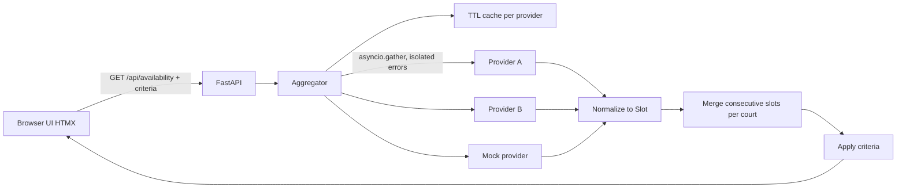

# Zagreb Tennis Availability Aggregator

## Decisions (from Q&A)
- Python 3.12 + FastAPI, `httpx` (async) for HTTP, Jinja2 + HTMX for UI; Playwright as an optional extra only if a system turns out to be JS-rendered.
- Single user, runs on localhost. No accounts. Criteria persisted in browser `localStorage`.
- On-demand fetch with in-memory TTL cache (default 10 min) + "Force refresh".
- Horizon default 14 days (editable). Deep-link to club booking page per slot.
- Defaults: weekdays 07:00–10:00 and 19:00–22:00; weekends any time; min block 2h, fully inside the window; tennis only (padel/squash dropped at adapter level); indoor/outdoor + surface shown as info with optional filter.
- Booking systems are unknown yet → adapter pattern; Phase 1 ships with a mock adapter, real adapters added one by one when endpoints arrive.

## Architecture

## Project layout
- `pyproject.toml`, `.env.example`, `README.md`
- `app/main.py` – FastAPI app, routes: `GET /` (page), `GET /api/availability` (JSON), `GET /partials/results` (HTMX fragment), `GET /api/providers` (status)
- `app/config.py` – `pydantic-settings`; provider enable flags + credentials from env (`OMNI_<PROVIDER>_USERNAME/PASSWORD`), cache TTL, timezone `Europe/Zagreb`
- `app/models.py` – `Club`, `Court` (name, sport, indoor: bool|None, surface: str|None), `Slot` (court, start, end, booking_url), `FreeBlock` (merged), `Criteria` (date range, weekday windows, weekend windows, min_minutes, indoor filter, club filter), `ProviderResult` (blocks + status/error)
- `app/criteria.py` – defaults; `merge_consecutive(slots) -> blocks`; `apply(blocks, criteria)`: clip block to window per day-type, keep if clipped length ≥ min
- `app/cache.py` – simple async TTL cache keyed by (provider, date range)
- `app/aggregator.py` – fan-out to enabled providers with per-provider timeout; one failing provider never fails the page; returns status per provider
- `app/providers/base.py` – `Provider` protocol: `key`, `club`, `async fetch(date_from, date_to) -> list[Slot]`; registry; shared helpers: `CookieSession` (form login → cookie jar, re-login on 401/redirect) and `TokenSession` (API login → bearer header, refresh on expiry)
- `app/providers/mock.py` – fixture-driven provider used for development and tests
- `app/providers/<system>.py` – one file per booking system (Phase 2)
- `app/templates/index.html`, `app/templates/partials/results.html` – filter form (criteria), results grouped day → club → court → block rows with "Book" link, provider status badges (ok / cached / error)
- `app/static/app.js` – load/save criteria in `localStorage`, serialize to query params, HTMX trigger
- `tests/test_criteria.py` (merging, window clipping, weekend/weekday, 2h minimum, DST edges), `tests/test_aggregator.py` (error isolation, cache), `tests/providers/` with recorded fixtures per adapter

## Phase 1 – core + mock (this plan)
1. Scaffold project, settings, models.
2. Implement merge + criteria logic with tests.
3. Aggregator with cache and error isolation.
4. UI with editable criteria and grouped list view.
5. Mock provider with realistic fixture (multiple clubs, 30-min and 60-min granularity, padel courts to verify exclusion).

## Phase 2 – real adapters (one per endpoint you provide)
For each system: inspect endpoint (JSON vs HTML vs JS-rendered), record a fixture, implement `fetch()`, map court → sport/indoor/surface, build `booking_url`, add credentials to `.env.example` if required. If JS-rendered, add `playwright` optional dependency and a `BrowserSession` helper.

## Run
`uv run uvicorn app.main:app --reload` (or `pip install -e . && uvicorn ...`), open `http://localhost:8000`.